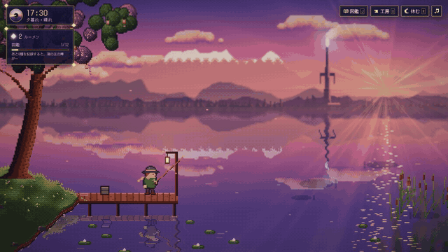
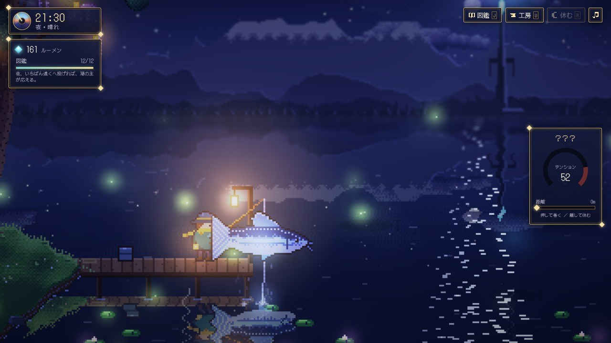
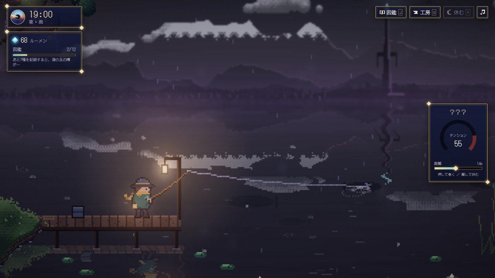
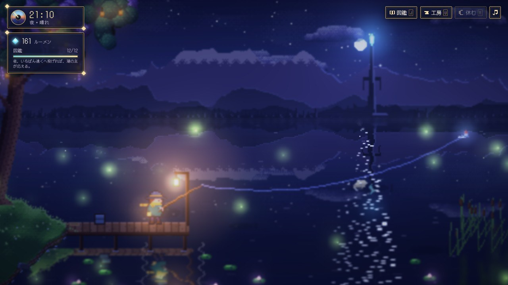
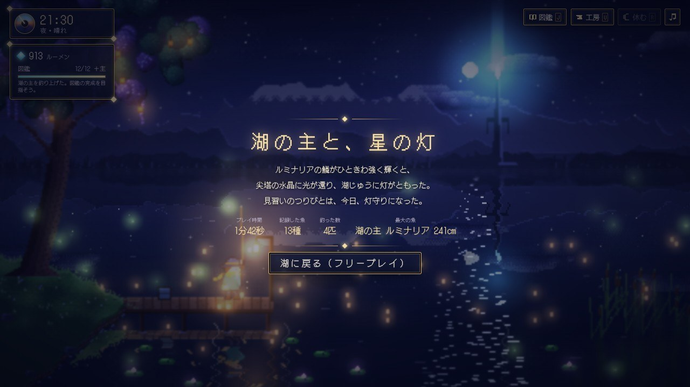
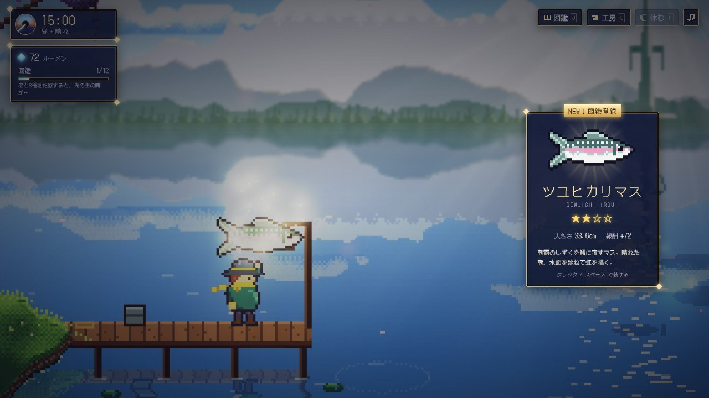
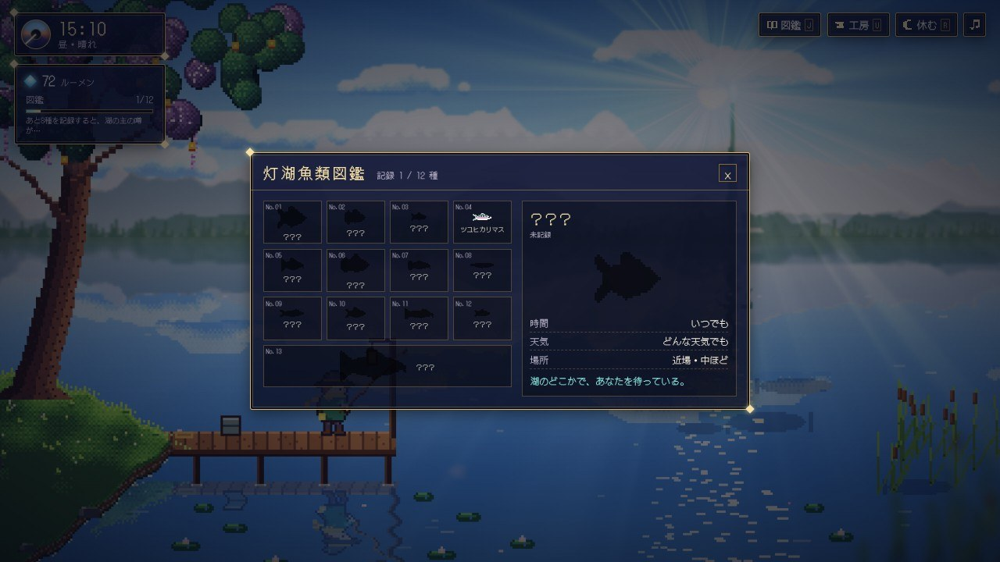

# 灯湖のつりびと — Lumina Mere

星が還る幻想の湖「灯湖ルミナ」で、見習いのつりびととして魚を釣り、図鑑を埋め、道具を鍛え、やがて湖の主に会いに行く。
オクトパストラベラーの HD-2D 表現に着想を得た、ドット絵 × 立体的な光と被写界深度のブラウザ釣りゲームです。10〜15分ほどで物語がひと区切りし、その後もフリープレイで図鑑の完成を目指せます。



▶ **ブラウザで遊ぶ: https://onego15.github.io/fishing-claude/** （GitHub Pages）

▶ 長めのプレイ動画（MP4・約120秒）: [docs/gameplay.mp4](docs/gameplay.mp4)

> GIF / MP4 はどちらも、このリポジトリのゲームをヘッドレス Chromium で実際に動かして撮影したものです（詳細は「動作確認結果」を参照）。

### スクリーンショット

| 夜：湖の主との対決 | 雨の宵 |
| --- | --- |
|  |  |
| 蛍の夜 | エンディング |
|  |  |
| 釣果カード | 魚類図鑑 |
|  |  |

---

## ゲームの特徴

- **HD-2D 風のビジュアル**
  - 480×270 の低解像度ドット絵レイヤー（奥景・中景・前景・発光）を WebGL2 で合成し、高解像度でシャープに拡大
  - 奥行きに応じた**被写界深度**（地平線や手前の草木はボケ、釣り人と浮きにピント）。キャスト中やファイト中は**フォーカスが浮きへ移動**
  - 発光レイヤーによる**ブルーム**と**ライティング**（ランタン・灯樹の実・蛍・水晶の尖塔が周囲を照らす）
  - **水面の鏡面反射**（波でゆらぐ空・山・尖塔・桟橋の映り込み）、太陽／月の光の道、波紋、雨粒の輪
  - 地平線の**大気遠近とボリューム霧**、太陽の**光芒（ゴッドレイ）**、ビネット、カラーグレーディング
  - 揺れる灯樹と藤のような花房、なびくスカーフ、蛍、花びら、渡り鳥、流れ星、雷
  - カメラはズーム／パン／手ぶれ／スローモーションで演出（釣り上げの瞬間はスローとフラッシュ）
- **昼夜と天候**: 時間は常に流れ（ゲーム内1時間＝現実30秒）、夜明け・昼・夕暮れ・夜で景色と釣れる魚が変わる。天候は晴れ・雨・霧。
- **魚ごとに特徴のあるファイト**: 12種＋湖の主。各魚は「引き」「突進」「跳躍」「潜行」「霧隠れ」の行動を独自の配分・リズムで使い分ける
  - 跳躍：空中では指を離し、着水の瞬間に押すと「ジャスト！」で大きく寄せられる
  - 霧隠れ：テンションゲージが見えなくなり、竿のしなりで判断する
  - 行動の前には「！」の予兆が出るので、読んで対応できる
- **収集と成長**: 魚類図鑑（サイズ記録・釣った数・出現条件のヒント）、ルーメン（通貨）で竿・糸・擬餌を3段階強化。竿や擬餌が足りない魚は「影」だけが現れてヒントをくれる
- **短時間でも達成感**: 9種を記録し「星灯りの擬餌」を手に入れて夜に遠投すると、湖の主ルミナリアが現れる。釣り上げるとエンディング（灯籠が空へ昇る演出）→ フリープレイへ
- **UI**: 夜のガラス板に金の細線を引いた統一デザイン。時計の文字盤、テンションの円形ゲージ、図鑑・工房、釣果カード（NEW!／記録更新バッジ）
- **サウンド**: 音声ファイルを使わず WebAudio で生成（湖のさざ波・風・雨・虫の声、ゆっくり流れるパッドとオルゴール風の旋律、全効果音）
- セーブはブラウザの localStorage に自動保存（「つづきから」で再開）

## 操作方法

| 操作 | キーボード | マウス / タッチ |
| --- | --- | --- |
| キャスト（長押しで力をため、離して投げる） | Space / Enter / Z 長押し | 画面を長押し |
| アワセ（ウキが沈んだら） | Space | クリック / タップ |
| リールを巻く ／ 休む | 押している間巻く ／ 離すと休む | 長押し ／ 離す |
| 仕掛けを回収（待機中） | Space | クリック |
| 図鑑 | J | 右上「図鑑」 |
| 工房（道具の強化） | U | 右上「工房」 |
| 休む（次の時間帯まで進める） | R | 右上「休む」 |
| 音のオン／オフ | M | 右上の音符 |
| 閉じる | Esc | × ボタン |

**ファイトのコツ**: テンションが赤い領域に入ったら指を離す。ゲージが100%のまま一定時間たつと糸が切れ、距離ゲージが右端まで行くと逃げられる。

## 起動・プレイ方法

ビルド不要の静的ファイルです。外部 CDN にも依存しません。

```bash
# どちらか一方でローカルサーバーを起動
python3 -m http.server 8000
# npx serve .
```

ブラウザで `http://localhost:8000/` を開きます。`index.html` をダブルクリックして直接開いても動作します（ES Modules を使っていないため）。

- 推奨: WebGL2 に対応したデスクトップの Chrome / Edge / Firefox / Safari
- WebGL2 が使えない環境では、被写界深度などを省いた簡易 2D 合成に自動で切り替わります
- `?demo` を付けて開くと、自動操縦ボットが遊ぶデモモードになります（動画撮影に使用したもの）

## 使用技術

- HTML / CSS / JavaScript（フレームワーク・ゲームエンジンなし、ビルドなし）
- Canvas 2D: すべてのドット絵をコードで生成・描画（キャラクターはドットマップ、魚は形状パラメータからの手続き生成、木・雲・山・水面も手続き生成）
- WebGL2（GLSL ES 3.0）: 自作の HD-2D コンポジタ（シャープバイリニア拡大、可変半径ディスクブラーによる被写界深度、レイヤー別パララックスズーム、ミップマップによるブルーム、fbm ノイズの霧、ゴッドレイ、トーンマッピング、グレーディング）
- Web Audio API: 生成音楽・環境音・効果音
- フォント: [DotGothic16](https://github.com/fontworks-fonts/DotGothic16)（SIL Open Font License 1.1、`assets/fonts/dotgothic16/OFL.txt`）。npm パッケージ `@fontsource/dotgothic16` から取得して同梱
- 録画: Playwright + ヘッドレス Chromium（SwiftShader）でフレーム単位キャプチャ → ffmpeg で MP4 / GIF に変換

フォント以外の画像・音声素材はすべてこのリポジトリのコードで生成しており、外部アセットは使っていません。

```
index.html          画面構成（タイトル・HUD・モーダル）
css/style.css       UI デザイン
js/core.js          数学・乱数・色ユーティリティ
js/env.js           時刻と天候、時間帯ごとのパレット
js/pixel.js         ドット絵生成（キャラクター、魚、葉、雲）
js/data.js          魚・装備のデータ
js/world.js         湖の世界の描画とアニメーション（4レイヤー）
js/post.js          WebGL2 HD-2D コンポジタ
js/fishing.js       ゲーム進行とファイトのロジック
js/ui.js            HUD・釣果カード・図鑑・工房・エンディング
js/audio.js         生成サウンド
js/main.js          メインループ・入力・デモ/撮影用フック
docs/               デモGIF・プレイ動画・スクリーンショット
tools/              録画に使ったスクリプト（Playwright のフレーム単位キャプチャ、GIF 変換）
```

## AI制作情報

| 項目 | 内容 |
| --- | --- |
| AIサービス名 | Claude（Anthropic）— Claude Code（claude.ai のクラウド実行環境・Projects） |
| 使用モデル名 | Claude Opus 5.5（実行環境の `get_session` で確認したモデルID: `claude-opus-5-5`。設定値は `claude-opus-5-5[1m]`＝1Mコンテキスト版） |
| ゲームエンジン・フレームワーク | なし（独自実装。Canvas 2D + WebGL2 + Web Audio API） |
| 使用言語 | JavaScript、GLSL ES 3.0、HTML、CSS |
| 制作に使用したプロンプト | 下記「制作に使用したプロンプト全文」 |

## 制作に使用したプロンプト全文

以下は依頼プロンプトを省略・要約・改変せずに転記したものです。

````text
オクトパストラベラーのHD-2D表現に着想を得た、美しく幻想的な釣りゲームを制作してください。

ブラウザで快適にプレイでき、10〜15分程度で一区切りつく、商業インディーゲームのような完成度を目指してください。

**最も重視するのは、奥行きのある美しいピクセルアート、統一されたアートスタイル、気持ちのよい演出、洗練されたUI/UXです。**

### ゲーム内容
- 幻想的な湖を舞台にした釣りゲーム
- 魚ごとに特徴のある釣りのミニゲーム
- 魚の収集、図鑑、装備のアップグレード
- 昼夜や天候による景色と釣れる魚の変化
- 短時間でも達成感のあるゲーム進行

### ビジュアル
- 2Dドット絵と立体的な空間表現を組み合わせたHD-2D風
- 奥行きのある背景、立体的な地形、自然なカメラワーク
- 美しいライティング、影、水面の反射、霧、被写界深度
- 木々の揺れ、水の波紋、蛍などの環境アニメーション
- ゲームの世界観と調和した統一感のあるUI
- 単純な図形や仮素材を並べただけのプロトタイプにはしない

### 制作方針
- 技術選定、ゲームエンジン、プログラミング言語、アセットの制作・調達方法は自由
- コンテンツ量よりも、ビジュアル・演出・操作感の完成度を優先する
- オリジナルの世界観とキャラクターデザインにする
- 必要に応じて、利用条件を遵守した公開アセットを使用してよい

### GitHub README
README.mdには以下を含めてください。

1. ゲームタイトルと簡単な紹介
2. **実際のゲームプレイを録画したGIFアニメーション**
   - READMEの冒頭付近に埋め込み、GitHub上で自動再生されるようにする
   - 10〜15秒程度
   - 釣り、魚のヒット、演出、景色など、ゲームの魅力が伝わる場面を収録
   - 可能なら長めのMP4プレイ動画も保存し、READMEからリンクする
   - GIFは `docs/demo.gif` に配置
3. ゲームの特徴と操作方法
4. 起動・プレイ方法
5. 使用技術
6. **制作に使用した、この依頼プロンプトの全文**
   - 省略・要約・改変せず、READMEにそのまま掲載する
   - 追加の制作指示があった場合はそれも記録する
7. 動作確認結果と既知の問題

GIFや動画は、実際に動作するゲームをキャプチャしたものを使用してください。静止画像を加工した架空のプレイ映像で代用しないでください。

### AI制作情報
READMEには、比較実験の記録として以下を記載してください。

- **AIサービス名：** ChatGPT / Claude / Gemini など
- **使用モデル名：** GPT-6 Astra / Claude 5.5 Opus / Gemini 4 Argon など、実際に使用したモデルの正式名称
- **ゲームエンジン・フレームワーク**
- **使用言語**
- **制作に使用したプロンプト全文**

モデル名やバージョンを実行環境から確認できない場合は、推測せず「未確認」と記載してください。

### 自律制作
私への途中確認や質問は不要です。

企画、設計、実装、素材制作、動作確認、バグ修正、ビジュアル改善、プレイ動画の録画、README作成まで、利用可能なツールの範囲で自律的に実施してください。

実際にブラウザでゲームを起動し、プレイ画面を確認して改善してください。

最終的に、ブラウザでプレイ可能なゲーム一式とREADMEを完成させてください。

実行環境の制約などで実施できなかった工程は、実施したかのように装わずREADMEに明記してください。
````

### 追加の制作指示

制作途中に、ユーザーから次の追加指示がありました（原文のまま）。

````text
https://github.com/onego15/fishing-claude.git
完成したらここにpush
````

参考として、プロジェクト内の調整役の Claude セッションから制作担当セッションへ渡された補足メモ（ユーザーの発言ではありません）を記録しておきます。

> くわさんの依頼メッセージ（ルートメッセージ）が全文の要件です。確認や質問はせず、自律的に最後まで制作してください。
> 補足事項:
> - リポジトリは未指定です。まず list_repos で使えそうな空リポジトリがあるか確認し、なければ成果物一式（ゲーム、README.md、docs/demo.gif、MP4）を /mnt/project-files/fishing-game/ に置いてください。新規リポジトリ作成が必要な場合は、その旨を報告で一言伝えてください。
> - README の使用モデル名は get_session ツールの session_context.model / last_served_model で確認したものを記載し、確認できなければ「未確認」としてください。
> - プロンプト全文はルートメッセージをそのまま転記してください。

## 動作確認結果と既知の問題

### 実施した確認

| 確認内容 | 結果 |
| --- | --- |
| 環境 | Playwright 1.56.1 + ヘッドレス Chromium（WebGL2 は SwiftShader によるソフトウェア描画）、1280×720 |
| JavaScript の構文チェック（`node --check` 全ファイル） | 問題なし |
| 起動・WebGL2 コンポジタの初期化 | 成功（シェーダのコンパイル／リンク成功、フォールバックに落ちないことを確認） |
| タイトル → ゲーム開始 → キャスト → 待ち → アタリ → ファイト（引き・突進・跳躍・潜行・霧隠れ）→ 釣り上げ → 釣果カード | 各状態のスクリーンショットを目視で確認。録画中も含めページエラー・コンソールエラーは 0 件 |
| 昼・夕暮れ・夜・夜明け、晴れ・雨（雷）・霧の見た目 | スクリーンショットで確認し、ランタン光の白飛び、夜の雪山・雲の明るさ、ブルームの飽和（色が反転する不具合）などを修正 |
| 図鑑・工房（購入）・休む（時間帯の切り替え）・エンディング → フリープレイ | 動作を確認（MP4 に収録） |
| キーボード（Space 長押し・J・U・Esc）とマウス長押しの入力 | 実時間モードで Playwright から入力し、反応することを確認 |
| 進行ペース | 描画を止めた高速シミュレーションで自動操縦ボットに通しプレイさせ、湖の主の撃破までゲーム内 約8.3分・27匹（失敗なし）。人が操作する場合は判断・メニュー操作・失敗を含めて 10〜15分程度になる見込み（推定値で、人による計測はしていません）。この結果を受けて、必要種数（8→9種）・装備価格・ファイトの強さを調整 |
| 描画負荷 | ソフトウェア描画の固定ステップ撮影で 1フレーム約45ms（世界の描画＋合成）。実 GPU での fps は未計測 |

### 実施できなかったこと・制約

- **実機 GPU のブラウザでの確認はできていません。** 実行環境はクラウドのコンテナで、画面を持つブラウザや GPU がないため、確認はすべてヘッドレス Chromium（WebGL2 はソフトウェア実装の SwiftShader）で行いました。
- **人の手による操作での通しプレイはしていません。** プレイ確認と録画は、ゲームに組み込んだ自動操縦ボット（プレイヤーと同じ入力フラグを押す・離すだけの簡単な AI）で行いました。
- **GIF / MP4 は実時間ではなく 1/30 秒ずつ進めて撮影しています。** ソフトウェア描画では実時間で 30fps を出せないため、ゲームを固定ステップで進めて毎フレームのスクリーンショットを連結しました。映っているのは実際に動作しているゲームそのものですが、録画の見栄えのため、いくつかの場面では撮影スクリプトから時刻・天候・掛かる魚を指定し、終盤のシーンでは図鑑の登録状態と装備を進めた状態から撮影しています（通常プレイと同じ処理で描画・進行しています）。
- **音声は録画に含まれていません**（ヘッドレス環境でのキャプチャのため）。サウンドの聴感確認もできていません。
- 依頼時点ではリポジトリの指定がなかったため、制作途中でユーザーから指定された `onego15/fishing-claude` に push しています。

### 既知の問題

- 実 GPU を積んだ PC・スマートフォンでのフレームレートと見た目は未確認です。ヘッドレス環境の実時間モードは表示合成がソフトウェアのため 2fps 程度しか出ず、実機の性能の参考になりません。
- スマートフォンはタッチ（長押し）で操作できる作りですが、実機では未確認です。縦持ちには最適化しておらず、横向きを推奨しています。
- 跳ねる魚は回転させて描画しているため、回転中はドットが少しガタつきます。
- 桟橋と釣り人の水面への映り込みは簡易的な鏡映で、角度によっては位置がやや不自然です。
- ブラウザの自動再生制限により、音は最初のクリック／キー入力の後から鳴ります。
- セーブは localStorage に保存するため、プライベートブラウズなどでは保存されないことがあります。
- 録画の終盤（湖の主のシーン）は撮影スクリプトで図鑑と装備を進めた状態から始めているため、エンディング画面のプレイ時間は実際の通しプレイより短く表示されています。
